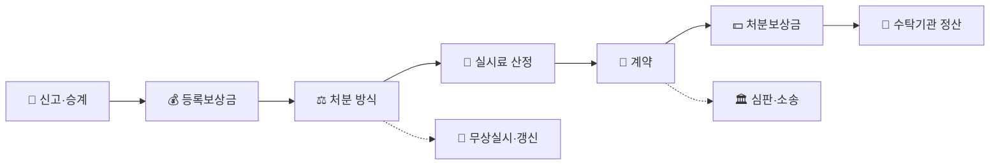

<div align="center">

# ⚖️ Patent Law MCP

**국유특허 업무를 법령 조항 단위로 계산하고 근거까지 붙여 주는 MCP 서버**

지식재산처 국가직무발명특허권 — 신고부터 보상·처분·수탁기관 정산·심판까지

[](https://github.com/kimjs3176-prog/patent-law-mcp/actions/workflows/ci.yml)


[빠른 시작](#quickstart) · [업무 흐름](#workflow) · [도구 32개](#tools) · [원문 대조](#verification) · [개발](#development)

</div>

---

```text
나  > 전용실시 3년, 공장도가격 5만·5.2만·5.4만 원, 연 1,000·1,500·2,000개, 점유율 0.2면 실시료 예정가격은?

MCP > calculate_royalty_estimate
      총판매예정수량 4,500개 × 52,000원 × 0.2 × 3.00% = 1,404,000원   (시행규칙 제11조 제2항·제3항)
      ⚠ 산정 총액이 최소실시료 3,000,000원보다 적습니다. 최소실시료 이상으로 정하십시오.   (고시 제9조)
```

모든 결과에는 **근거 조항**과 **원문 확인이 필요한 쟁점**(`legal_audit_basis.unverified_items`)이 함께 나옵니다.

## 🧭 원칙

| 원칙 | 하는 일 |
|:---|:---|
| 모르면 모른다고 답함 | 조회 실패·원문에 없는 값은 `found=False`·`warnings`·`미확인`으로 반환. 특허번호·출원인·수치를 지어내지 않음 |
| 받은 문서는 번호로 검증 | Google Patents·KIPRIS 문서의 출원·등록·공개번호가 요청과 다르면 버림 |
| 기준값은 한 파일에서 관리 | 최소실시료·기본율·보상 비율·감액기준과 근거 조항은 `policies/*.yaml`. 고치면 다음 호출부터 반영 |
| 원문과 어긋나면 표시 | 법령끼리 표현이 다른 항목은 해당 도구 결과에만 `unverified_items`로 표시 |

<a id="workflow"></a>

## 🔄 업무 흐름



단계마다 대응하는 도구는 아래 [도구](#tools) 표에 있습니다.

<a id="quickstart"></a>

## 🚀 빠른 시작

**Claude Desktop (로컬, stdio)** — `claude_desktop_config.json`에 추가합니다.

```json
{
  "mcpServers": {
    "patent-law-mcp": {
      "command": "uv",
      "args": ["--directory", "/절대경로/patent-law-mcp", "run", "patent-law-mcp"],
      "env": {
        "KIPRIS_API_KEY": "선택: KIPRIS Plus 인증키",
        "LAW_OC": "선택: 국가법령정보 공동활용 OC",
        "PATENT_LAW_MCP_PROFILE": "national"
      }
    }
  }
}
```

인증키 없이도 국유특허 업무 도구(계산·판정·안내)는 모두 동작합니다.

<details>
<summary><b>원격(HTTP)·Docker 배포</b></summary>

```bash
PATENT_LAW_MCP_TOKEN=긴-임의-문자열 uv run patent-law-mcp --transport streamable-http --host 0.0.0.0 --port 8000 --allowed-host mcp.example.org
```

```bash
docker build -t patent-law-mcp .
```

```bash
docker run -p 8000:8000 -e PATENT_LAW_MCP_TOKEN=긴-임의-문자열 -e KIPRIS_API_KEY=... patent-law-mcp --allowed-host mcp.example.org
```

- 클라이언트는 `https://<host>/mcp`에 `Authorization: Bearer <토큰>` 헤더로 접속합니다.
- 토큰 없이 127.0.0.1 이외 주소에 바인딩하면 서버가 시작을 거부합니다.

</details>

### 인증키 (모두 선택)

| 환경변수 | 쓰는 도구 | 발급 |
|:---|:---|:---|
| `KIPRIS_API_KEY` | 특허 검색, 출원번호 조회, KIPRIS 공식 서지 | plus.kipris.or.kr (특허·실용 공개·등록공보 서비스) |
| `LAW_OC` | 법령 검색·조문 조회 | open.law.go.kr Open API 신청 (무료). **호출 서버의 IP·도메인 등록 필요** |

키가 없으면 해당 도구는 발급 방법을 안내하고, 등록·공개번호 조회는 Google Patents 공개 웹으로 동작합니다.

<a id="tools"></a>

## 🧰 도구

### 1. 국가직무발명특허권 업무 — 핵심

| 업무 단계 · 도구 | 하는 일 · 근거 |
|:---|:---|
| **📝 신고·승계**<br>`process_invention_disclosure` | 신고서(별지 제1호)·성질 설명서 3항목·요약서 (시행규칙 제2조), 승계 고려사항 (제3조), 국가 명의 부기 명칭 (고시 제26조), 등록요청 서류 (시행규칙 제4조) |
| **💰 등록보상**<br>`calculate_registration_compensation` | 특허 50만·실용신안 30만·디자인 20만 원 범위, 동일 발명 1회 (영 제16조), 별표 1 감액 |
| **⚖️ 처분 방식**<br>`plan_national_disposal` | 유상·무상 4개 사유 (영 제10조), 수의계약·경쟁입찰과 예외 7개 (영 제11조), 계약기간 3년+연장 (시행규칙 제6조), 입찰 공고 30일 전 (제7조), 신청서류·계약서 기재사항 (제8·9조) |
| **🧮 실시료 산정**<br>`calculate_royalty_estimate` | 총판매예정수량 × 공장도가격 평균 × 점유율 × 기본율 3%(2~4%), 단위당 실시료, 매각 예정가격 (시행규칙 제11조), 중소기업 재실시 2% (고시 제7조) |
| **📄 계약**<br>`design_licensing_terms`<br>`review_licensing_contract` | 계약조건 초안 (시행규칙 제11조 산식·최소실시료 300만 원·경쟁입찰), 계약서 필수 조항 점검 |
| **🔁 무상실시·갱신**<br>`evaluate_unutilized_free_license`<br>`evaluate_exclusive_renewal` | 미활용 특허 무상실시 (고시 제3~7조), 전용실시 갱신 5개 사유·30일 전 신청 (고시 제10조) |
| **💵 처분보상**<br>`calculate_disposal_compensation` | 직접비용 공제 후 50% (고시 제11조 제2항), 별표 1 감액, 발명자별 비과세·과세 |
| **🏢 수탁기관**<br>`get_trustee_obligations` | 분기 실적보고 다음 달 15일 (고시 제18조), 대장 분기 통지 (시행규칙 제13조), 승인·처분결과 통지·만료 후 정산 (고시 제17조, 시행규칙 제12조), 변경 30일 내 통보, 금품 수수 금지, 기여보상금 15% 범위 (영 제18조) |
| **🏛️ 심판·소송**<br>`guide_national_dispute` | 심판당사자 지정·대리인 선임, 패소 시 소 제기 협의 (30일 불변기간), 국가소송법 준용 (고시 제21~24조) |
| **📋 기준값**<br>`get_policy_table` | 적용 중인 기준값·근거 조항·원문 확인 필요 항목 |

### 2. 권리 유지·기한 관리

| 도구 | 하는 일 |
|:---|:---|
| `calculate_annuity_schedule` | 연차료 납부기한·추가납부기간·회복 가능기간과 현재 상태 |
| `check_portfolio_annuities` | 보유 특허 여러 건을 소멸 추정 → 회복 가능 → 추가납부 → 임박 순으로 정렬 |
| `calculate_patent_term` | 존속기간 만료일 (특허 20년·실용신안 10년, 연장 반영) |
| `calculate_patent_deadline` | 특허법 제14조 기간 계산 (공휴일·토요일·노동절 반영) — 우선권 12개월, PCT 31개월, 심사청구 3년, 공지예외 12개월 |
| `check_patent_rights_status` | 번호 조회 + 존속기간 + 연차료 상태 한 번에 |

### 3. 원문 확보·기술 분석

| 도구 | 하는 일 |
|:---|:---|
| `search_patents` · `fetch_patent_smart` · `inspect_and_summarize_by_appno` | KIPRIS 검색, 번호 검증 조회(해외 포함), 조회 후 요약 |
| `search_laws` · `get_law_article` | 법령·행정규칙 검색, 조문 원문·시행일 |
| `parse_raw_patent_text` · `analyze_patent_document` · `summarize_patent` | 붙여넣은 공보 분해, 원문 발췌 요약 초안 |
| `ground_summary_figures` · `ground_patent_applications` · `evaluate_commercialization` | 근거 없는 효과 수치·용도 걸러내기, TRL 판정 |
| `verify_tech_transfer_scope_match` | 청구항 구성요소와 제품 설명 1차 대조 (침해 감정 아님) |
| `get_bundled_sample_patent` | 시연용 **가상** 샘플 (실존 특허 아님) |

### 4. 기술 마케팅 보조

| 도구 | 하는 일 |
|:---|:---|
| `bundle_patents_for_transfer` · `find_target_licensees_by_patent` | 패키지 구성, IPC→KSIC 참고 매핑과 수요기업군 |

## 🏷️ 기관 유형별 프로파일

| 프로파일 | 파일 | 적용 |
|:---|:---|:---|
| `national` **(기본)** | `policies/kipo_notice_rules.yaml` | 국유특허 — 국가공무원 등 직무발명 규정·시행규칙, 지식재산처고시 제2025-4호 |
| `public_research` | `policies/public_research.yaml` | 대학 산학협력단·정부출연연구기관 — 기술이전법·발명진흥법·기관 규정 |
| `private_company` | `policies/private_company.yaml` | 민간 기업 — 발명진흥법·사내 보상규정 |

| 설정 | 기본값 | 설명 |
|:---|:---|:---|
| `PATENT_LAW_MCP_PROFILE` | `national` | 기본 프로파일. 도구마다 `profile` 인자로 호출 단위 선택도 가능 |
| `PATENT_LAW_MCP_POLICY_FILE` | — | 다른 정책 YAML 경로 |
| `PATENT_LAW_MCP_CACHE` | `~/.cache/patent-law-mcp/cache.sqlite3` | 조회 캐시 경로, `off`면 끔 (특허 원문 7일, 검색·법령 24시간) |
| `PATENT_LAW_MCP_CACHE_TTL_HOURS` | `168` | 캐시 기본 보관 시간(시간 단위) |

기관·사내 규정 값(보상 비율 등)은 비워 두었습니다(`null`). 기관 값을 YAML에 넣거나 호출할 때 `payout_ratio`로 주십시오. 국유특허 계약조건 초안은 기업 규모별 참고 요율 대신 시행규칙 제11조 산식(`share_rate` × 기본율 3%)을 씁니다. 캐시는 성공한 조회만 저장하며, `refresh=True`를 주면 무시합니다.

<a id="verification"></a>

## 📚 원문 대조 결과

국가법령정보센터 원문과 2026-11-08·2026-11-22에 대조했습니다.

| 대상 | 확인한 원문 |
|:---|:---|
| 고시 | 국가공무원 등 직무발명의 처분·관리 및 보상 등에 관한 업무 운영요령 [지식재산처고시 제2025-4호, 2025.10.30. 시행] 제3~11조·제13~24조·제26조, 별표 1 |
| 규정 | 같은 규정 [대통령령 제35809호, 2025.10.01. 시행] 제2·5·8·10·11·12·14·16·17·18·21조 |
| 시행규칙 | 같은 규정 시행규칙 [총리령 제2054호, 2025.10.01. 시행] 제2~13조 |
| 법률 | 특허법 [법률 제21134호, 2025.11.11. 시행] 제14·30·54·55·59·79·81·81조의3·88·186·201조, 실용신안법 제22조, 발명진흥법 제12·13조, 같은 법 시행령 제7조, 소득세법 시행령 제17조의3 |

> [!WARNING]
> **원문끼리 표현이 달라 남겨 둔 쟁점** — 해당 도구 결과의 `unverified_items`에 표시됩니다.
> - **처분보상금 비율**: 규정 제17조 제1항은 "처분수입금의 100분의 50 **이상**의 범위에서 고시하는 바에 따라", 고시 제11조 제2항은 "직접비용을 **공제한** 금액의 100분의 50". 도구는 고시 산식을 적용합니다.
> - **무상실시 근거**: 고시 제3조 제2항은 근거를 영 제10조 제2항 **제1호**로 들지만, 현행 제1호는 '농업인·어업인의 소득 증대'입니다 (2024.11.12. 영 개정).
> - **보상금 감액**: 고시 별표 1은 비밀유지 위반 시 '기관포상금(영 제18조 제1항)'도 감액 대상으로 적지만, 현행 영 제18조는 수탁기관 '기여보상금'입니다 (기관포상금은 2024.11.12. 영 개정으로 폐지).

<details>
<summary><b>원문과 일치를 확인한 수치·기한</b></summary>

| 항목 | 값 | 근거 |
|:---|:---|:---|
| 미활용 특허 무상실시 | 등록 후 3년 미실시, 최대 3년 | 고시 제3조 |
| 중소기업 재실시 기본율 | 2%로 낮추어 적용 가능 | 고시 제7조 |
| 전용실시 최소실시료 | 300만 원, 계약일부터 60일 (수의계약·갱신에도 적용) | 고시 제9조 |
| 전용실시 갱신 | 5개 사유, 만료일 30일 전 신청 | 고시 제10조 |
| 처분보상금 | 직접비용 공제 후 100분의 50 | 고시 제11조 제2항 |
| 보상금 감액 | 통지 전 자기 명의 출원·이전 → 전액 미지급 / 미신고 출원·이전 → 전액 미지급 또는 50% / 비밀유지 위반 → 50% | 고시 별표 1 |
| 수탁기관 보고 | 분기 실적보고 다음 달 15일, 변경 30일 내 통보 | 고시 제18조·제15조 |
| 등록보상금 | 특허 50만·실용신안 30만·디자인 20만 원 범위, 1회 | 영 제16조 |
| 기여보상금 | 처분수입금의 100분의 15 범위 | 영 제18조 |
| 실시료 예정가격 | 기본율 3% (2~4%), 단위당 실시료 가능 | 시행규칙 제11조 |
| 계약기간 | 3년 이내 (준비기간 1년 이상·존속기간 4년 내 만료 시 연장) | 시행규칙 제6조 |
| 입찰 공고 | 입찰일 30일 전 | 시행규칙 제7조 |
| 심결 취소소송 | 등본 송달일부터 30일 (불변기간) | 특허법 제186조 |
| 연차료 회복 | 추가납부기간 만료일부터 3개월, 특허료 2배 | 특허법 제81조의3 |
| PCT 국내단계 | 2년 7개월 | 특허법 제201조 |
| 직무발명 승계 | 예약승계 규정 있으면 완성 때 승계, 승계하지 않을 때만 4개월 내 통지 | 발명진흥법 제13조 |
| 직무발명보상금 비과세 | 연 700만 원, 특수관계인 제외 | 소득세법 시행령 제17조의3 |

</details>

## 🔁 업스트림 동기화

요약 근거 확인·용도 근거·TRL 정합성 규칙은 [patent-summary-wizard](https://github.com/kimjs3176-prog/patent-summary-wizard)에서, 공보 특허권자 추출과 영상 시그니처 규칙은 [patent-video-skill](https://github.com/kimjs3176-prog/patent-video-skill)에서 옮겨 왔습니다. 매일 GitHub Actions가 변경을 확인해 `upstream-sync` 이슈를 열며, 반영 절차는 [`upstream/README.md`](upstream/README.md)에 있습니다.

<a id="development"></a>

## 🛠️ 개발

```bash
uv sync
```

```bash
uv run pytest -q
```

```bash
uv run python scripts/scenario_check.py
```

```bash
python3 scripts/sync_upstream.py --check
```

`scenario_check.py`는 서버를 별도 프로세스로 띄워 MCP 프로토콜(stdio·HTTP)로 49개 실사용 시나리오를 점검합니다. 네트워크가 없으면 `--offline`을 붙이십시오.

---

> [!IMPORTANT]
> **면책** — 이 서버는 변리사의 출원 대리, 명세서 작성, 심사 대응, 침해 감정을 대체하지 않습니다. 계약·보상·기한 계산 결과는 실무 검토용 초안이며, 최종 판단은 법령·고시 원문과 등록원부, 전문가 검토로 확인하십시오.

<div align="center">

만든 사람 · [@kimjs3176-prog](https://github.com/kimjs3176-prog)

</div>
